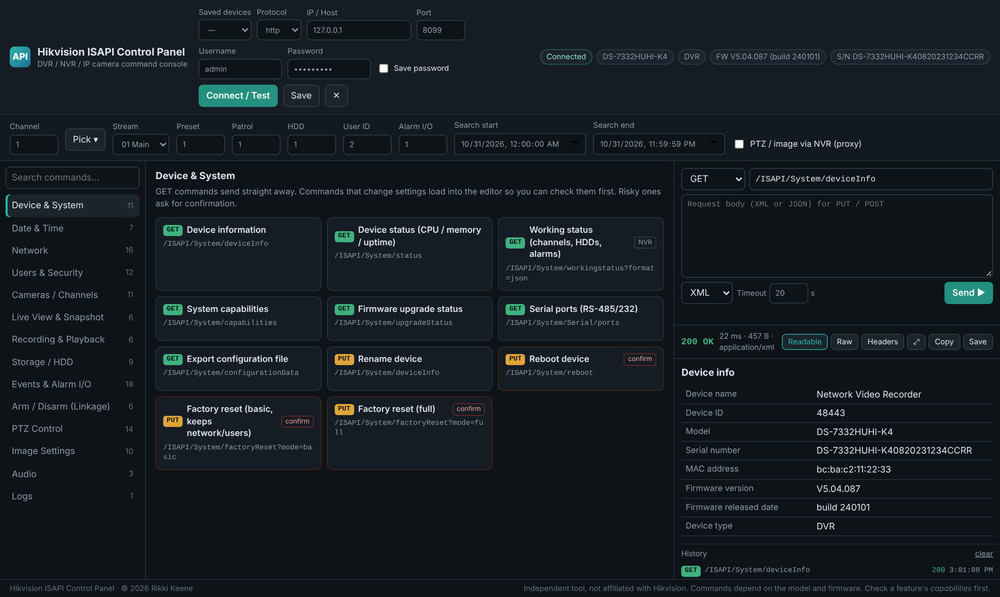
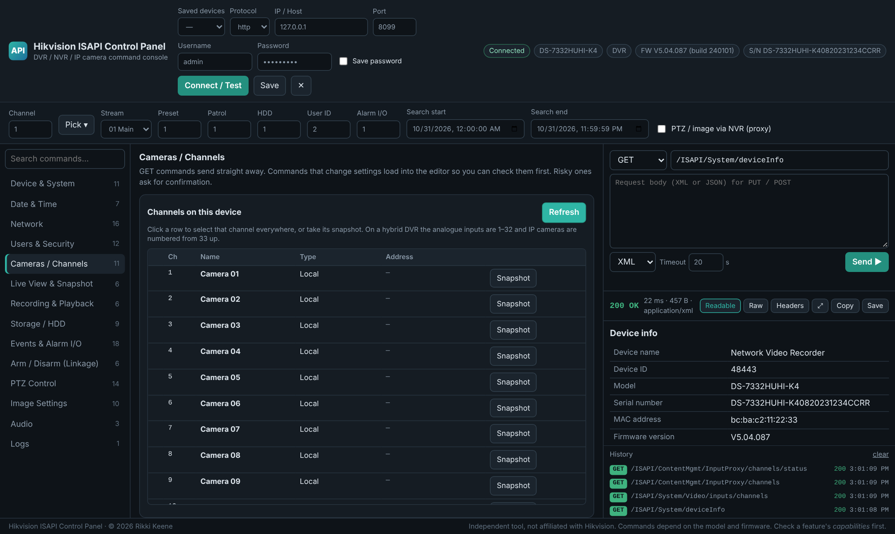
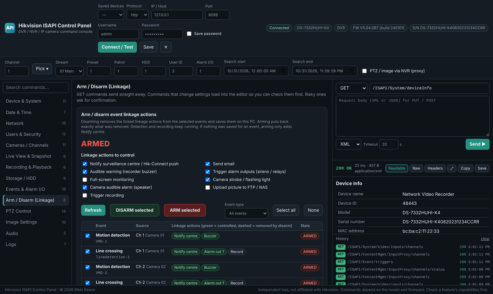
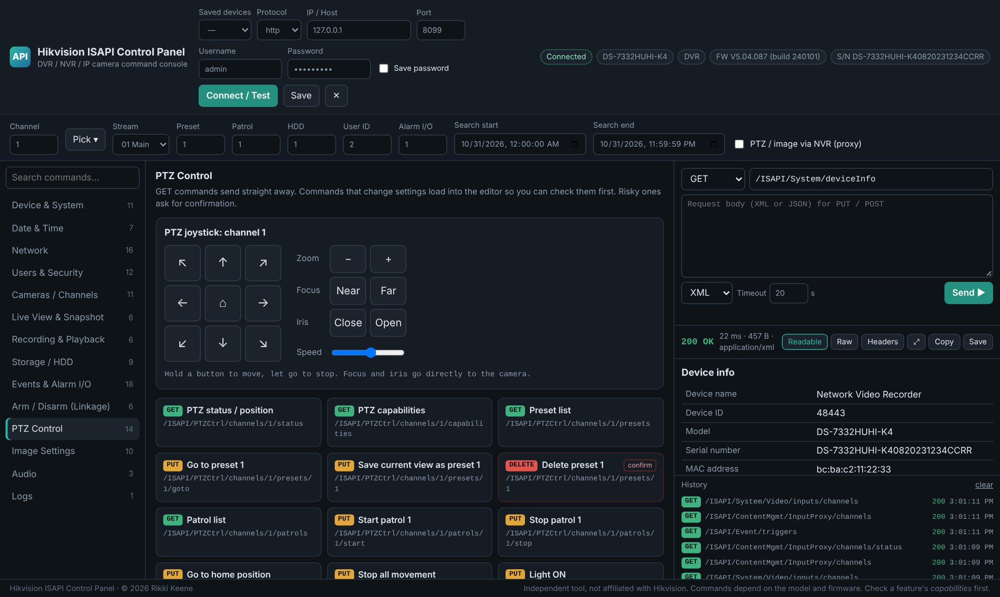
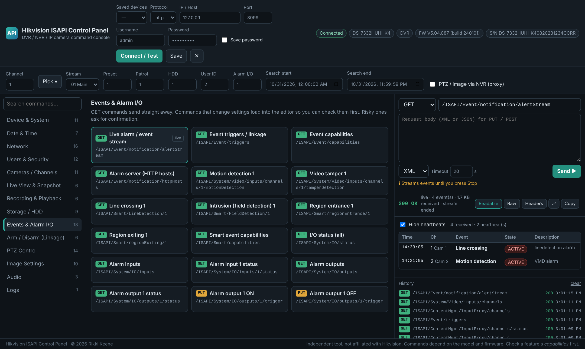
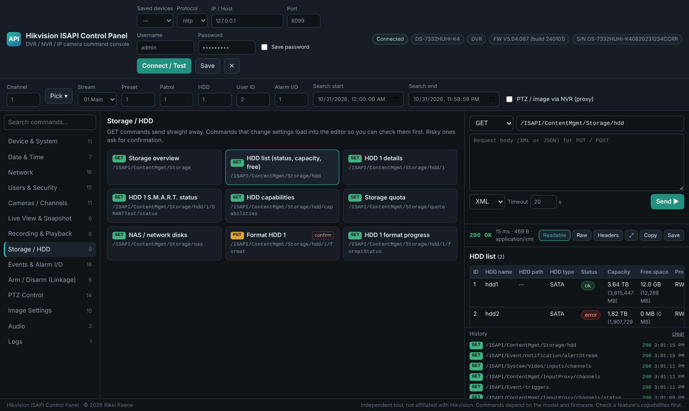

# Hikvision ISAPI Control Panel

A browser-based control panel for Hikvision DVRs, NVRs and IP cameras. It gives you a
clickable GUI over the Hikvision **ISAPI** HTTP interface — around 130 commands as
buttons, a PTZ joystick, an arm/disarm page for event linkage actions, a live event
stream and readable responses — without typing XML by hand.

The panel is a single HTML page. A small Python helper runs on your PC and relays the
requests to the recorder, because a web page cannot talk to a Hikvision device directly
(the recorder blocks cross-site browser requests and uses Digest authentication).



---

## Why the Python helper?

A plain web page can't reach a recorder on its own:

- Hikvision devices send no CORS headers, so the browser blocks the request.
- ISAPI uses **Digest** authentication (newer NVRs require SHA-256).
- Mixing `http` page → `https` device is blocked as mixed content.

`hik_isapi_tool.py` runs only on your PC (bound to `127.0.0.1`), handles the Digest
login and forwards the panel's requests to the recorder. Nothing leaves your machine.

---

## Requirements

- Python 3.8 or newer ([python.org](https://www.python.org/)). No extra packages — standard library only.
- A modern browser.
- Network access from your PC to the recorder.

## Running it

1. Keep `hik_isapi_tool.py` and `hik_isapi_tool.html` in the same folder.
2. Run it:
   ```
   python hik_isapi_tool.py
   ```
   Your browser opens at <http://127.0.0.1:8088>.
3. Enter the recorder's IP, port (80 by default), username and password, then click
   **Connect / Test**. The device model, firmware and serial number appear in the badge.

Options:
```
python hik_isapi_tool.py --port 9000 --no-browser
python hik_isapi_tool.py --bind 0.0.0.0   # expose to the LAN (see Security)
```

---

## Features

### Command catalogue
Around 130 ISAPI commands grouped into 13 sections: Device & System, Date & Time,
Network, Users & Security, Cameras / Channels, Live View & Snapshot, Recording &
Playback, Storage / HDD, Events & Alarm I/O, Arm / Disarm, PTZ, Image Settings, Audio
and Logs. Shared fields at the top (Channel, Stream, Preset, HDD, User, Alarm I/O, and
the recording search range) fill into every command — e.g. camera 1 main stream becomes
`101`. Any ISAPI endpoint can also be typed by hand in the request editor
(`Ctrl`+`Enter` sends).

### Channel picker


The **Pick** button (and the Cameras / Channels table) reads the device's real channels
with a green/red dot for online/offline, so you select a camera instead of guessing its
number. It merges `/ISAPI/System/Video/inputs/channels` (local/analogue inputs) with
`/ISAPI/ContentMgmt/InputProxy/channels` and `.../status` (IP cameras and their state).
On a hybrid DVR such as the DS-7332HUHI-K4, the analogue inputs are 1–32 and IP cameras
are numbered from 33 up.

### Arm / Disarm (event linkage)


Arms and disarms the **linkage actions** of selected events. Disarming removes the
chosen actions (push notification / Notify Surveillance Centre, email, recorder buzzer,
alarm outputs, camera strobe, camera audio, FTP, recording) from each event and saves
exactly what was removed on your PC. Arming restores it, including which alarm output
each event fired. Detection and recording keep running throughout. It works by editing
each event's linkage list via `/ISAPI/Event/triggers/<id>`; the account needs the
**Remote: Parameters Settings** permission.

> Note: the removed settings are saved in the browser on this PC. Arming from a
> different PC can only restore *Notify Surveillance Centre*. Disarming
> *Notify Surveillance Centre* also stops events reaching the live event stream.

### PTZ control


A joystick (hold to move, release to stop), zoom/focus/iris, a speed slider, presets,
patrols and auxiliary controls (light, wiper). A tick-box routes PTZ and image commands
through an NVR to its cameras.

### Live event stream


Streams `/ISAPI/Event/notification/alertStream` into a live event table (time, channel,
event type, state), with heartbeat messages hidden.

### Readable responses


Replies render as labelled tables instead of raw XML: disk sizes in GB/TB, uptime in
days/hours, statuses as green/red chips, tidier dates. **Raw** and **Headers** tabs are
there when you need them, and the ⤢ button widens the response panel.

### Other
- Saved devices with optional password storage.
- Snapshots shown inline as images, with download.
- RTSP / playback URL builder.
- Configuration backup download.
- Request history you can click to replay.
- Confirmation prompts on reboot, factory reset, HDD format, IP change, and user
  changes/deletes.
- Digest auth negotiates the strongest algorithm the device offers (SHA-256 → MD5), and
  retries only once after a 401 so a wrong password counts as a single failed login.

---

## Security notes

- By default the helper listens on `127.0.0.1` only — reachable just from your PC.
- `--bind 0.0.0.0` exposes the page to your LAN; anyone who can open it can relay
  commands to your devices. Only do this on a trusted network.
- The page is protected by a per-session token so other local processes can't use the
  relay.
- Saved passwords (if you tick "Save password") are stored in your browser's
  `localStorage` in plain text, as is the arm/disarm restore data. Clear them from the
  saved-devices list if that matters.

---

## Compatibility

ISAPI commands vary by model and firmware. Not every button works on every device — a
button that returns `notSupport` isn't available on that model. Check a feature's
`capabilities` endpoint first. Tested against a hybrid Turbo HD DVR (DS-7332HUHI-K4).
Reports of what works or fails on other models are welcome.

This is an independent tool and is not affiliated with or endorsed by Hikvision.

---

## Credit

Created by **Rikki Keene**. © 2026 Rikki Keene.
